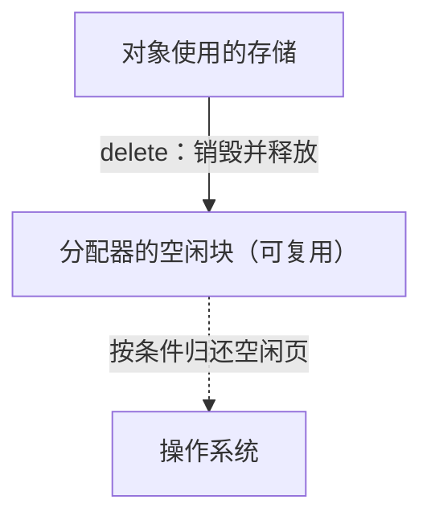

局部 `std::vector` 为什么能装下几百万个元素，又能在函数返回时自动释放？先分清**对象本身、它管理的数据，以及谁负责销毁它们**。

## 先看内存区的整体分工

下面按 Linux 常见实现画出虚拟地址空间：指针中的地址是进程看到的编号，不是物理内存条的位置。

```render html title="常见虚拟地址布局示意，区域不按比例。页表再把这些地址映射到物理页。"
<style>
  .memory-map svg { display: block; width: 100%; }
</style>
<div class="memory-map" aria-label="进程虚拟地址空间"></div>
<script>
  const scene = document.querySelector('.memory-map');
  function draw() {
    const w = scene.clientWidth, narrow = w < 430, x = narrow ? 22 : 100, width = narrow ? 116 : 200, label = x+width+24;
    const regions = [
      {y:40,h:58,name:'栈',detail:'局部对象',tone:'var(--accent)'},
      {y:118,h:42,name:'其他映射',detail:'动态库、文件'},
      {y:180,h:72,name:'堆',detail:'动态分配',tone:'var(--accent)'},
      {y:276,h:54,name:'.data / .bss',detail:'全局 / static'},
      {y:330,h:48,name:'.rodata',detail:'字符串字面量'},
      {y:378,h:48,name:'.text',detail:'机器指令'}
    ];
    scene.innerHTML = `<svg viewBox="0 0 ${w} 466" role="img" aria-label="高地址一侧为栈，中间有映射和堆，低地址一侧有静态数据、只读数据和代码">
      <text x="${x}" y="17" fill="var(--muted)" font-size="12">高地址</text><text x="${x}" y="451" fill="var(--muted)" font-size="12">低地址</text>
      <path d="M${x-12} 36V426" stroke="var(--rule-strong)"/>
      ${regions.map(r => `<rect x="${x}" y="${r.y}" width="${width}" height="${r.h}" fill="${r.tone||'var(--rule)'}" fill-opacity="${r.tone?'.12':'.24'}" stroke="${r.tone||'var(--rule-strong)'}" ${r.name==='其他映射'?'stroke-dasharray="4 4"':''}/><text x="${x+width/2}" y="${r.y+r.h/2+5}" text-anchor="middle" fill="var(--text)" font-size="${r.name.startsWith('.')?13:16}" font-family="${r.name.startsWith('.')?'var(--font-mono)':'var(--font-sans)'}">${r.name}</text><path d="M${x+width} ${r.y+r.h/2}h16" stroke="var(--rule-strong)"/><text x="${label}" y="${r.y+r.h/2+5}" fill="var(--muted)" font-size="${narrow?12:14}">${r.detail}</text>`).join('')}
      <path d="M${x+width/2} 100v12m-4-4 4 4 4-4M${x+width/2} 178v-12m-4 4 4-4 4 4" fill="none" stroke="var(--accent)" stroke-width="1.5"/>
    </svg>`;
  }
  new ResizeObserver(draw).observe(scene);
</script>
```

C++ 规定存储期与生命周期，不要求固定的五区布局。局部值也可能放在寄存器中或被优化掉；下文按需要实际存储的情况理解。

## 跟着一个函数看：对象和数据各在哪

先只看这几行，假设使用默认分配器：

```cpp
void work() {
    int count = 3;
    static int calls = 0;
    ++calls;
    std::vector<int> values(count, 7);
}
```

`count`、`values` 每次调用重新创建，`calls` 跨调用保留。vector 自身只存管理信息，元素另行分配；`sizeof(values)` 不包含那片元素。点“函数返回”看清理过程：

```render html title="vector 对象与元素不在同一片存储里。函数返回会触发拥有者的析构。"
<style>
  .lifetime-lab { --dynamic: #386f9b; padding-block: 8px; }
  :root[data-theme="dark"] .lifetime-lab { --dynamic: #8ebce2; }
  .lifetime-top { display: flex; flex-wrap: wrap; justify-content: space-between; align-items: baseline; gap: 8px; margin-bottom: 16px; font-size: 14px; }
  .lifetime-phase { color: var(--muted); }
  .lifetime-scene svg { display: block; width: 100%; }
  .lifetime-controls { display: flex; flex-wrap: wrap; align-items: center; gap: 10px 22px; margin-top: 12px; }
  .lifetime-controls button { min-height: 44px; border: 0; border-bottom: 1px solid var(--rule-strong); border-radius: 0; padding: 4px 0; background: transparent; font-size: 15px; cursor: pointer; }
  .lifetime-controls .lifetime-next { color: var(--accent-ink); border-color: var(--accent); }
  .lifetime-note { display: block; margin-top: 14px; min-height: 2em; color: var(--muted); font-size: 13px; }
</style>
<section class="lifetime-lab" data-returned="false" aria-label="函数调用中的局部对象、动态元素与静态对象">
  <div class="lifetime-top"><span>第 <b class="lifetime-call">1</b> 次调用 work()</span><span class="lifetime-phase">即将返回</span></div>
  <div class="lifetime-scene"></div>
  <div class="lifetime-controls"><button type="button" class="lifetime-next">函数返回</button><button type="button" class="lifetime-reset">重置</button></div>
  <output class="lifetime-note" aria-live="polite">沿着箭头看：values 拥有另一片存储中的三个元素。</output>
</section>
<script>
  const lab = document.querySelector('.lifetime-lab'), scene = document.querySelector('.lifetime-scene');
  const next = document.querySelector('.lifetime-next');
  let calls = 1, returned = false;
  function draw() {
    const w = scene.clientWidth, narrow = w < 500, bx = narrow?12:24, bw = narrow?w-24:w*.37;
    const dx = narrow?bx:w*.64, dy = narrow?228:82, dw = narrow?bw:w*.33;
    const sy = narrow?364:228;
    const text = (x,y,label,fill='var(--text)',size=14) => `<text x="${x}" y="${y}" fill="${fill}" font-size="${size}">${label}</text>`;
    scene.innerHTML = `<svg viewBox="0 0 ${w} ${sy+76}" role="img" aria-label="${returned?'局部对象销毁，元素存储归还分配器，calls 保留':'局部 values 指向动态元素，静态 calls 独立保留'}">
      <defs><marker id="owner-arrow" viewBox="0 0 10 10" refX="8" refY="5" markerWidth="5" markerHeight="5" orient="auto"><path d="M1 1L8 5L1 9" fill="none" stroke="var(--dynamic)" stroke-width="1.5"/></marker></defs>
      ${text(bx,22,'本次调用 · 通常在栈上','var(--muted)',13)}
      <path d="M${bx} 40v128h${bw}V40" stroke="${returned?'var(--rule)':'var(--rule-strong)'}" fill="none" ${returned?'stroke-dasharray="4 5"':''}/>
      ${returned?`${text(bx+16,85,'局部对象已销毁','var(--muted)')}${text(bx+16,120,'栈空间可以复用','var(--muted)',13)}`:`${text(bx+16,76,'count = 3')}${text(bx+16,124,'values')}<circle cx="${bx+bw-24}" cy="120" r="3" fill="var(--dynamic)"/>`}
      ${text(dx,dy-18,'动态存储','var(--dynamic)',13)}
      ${returned?`<path d="M${dx} ${dy}h${dw}v60h-${dw}z" fill="none" stroke="var(--rule-strong)" stroke-dasharray="4 5"/>${text(dx+12,dy+36,'已归还分配器','var(--muted)',13)}`:[0,1,2].map(i=>`<rect x="${dx+i*dw/3}" y="${dy}" width="${dw/3}" height="60" fill="var(--dynamic)" fill-opacity=".09" stroke="var(--dynamic)"/><text x="${dx+(i+.5)*dw/3}" y="${dy+38}" text-anchor="middle" fill="var(--dynamic)" font-size="22">7</text>`).join('')}
      ${!returned?`<path d="${narrow?`M${bx+bw-24} 120v78H${dx+dw/2}v26`:`M${bx+bw-24} 120H${dx-8}`}" fill="none" stroke="var(--dynamic)" stroke-width="1.5" marker-end="url(#owner-arrow)"/>`:''}
      <path d="M${bx} ${sy}H${w-12}" stroke="var(--rule)"/>
      ${text(bx,sy+30,'静态存储','var(--muted)',13)}${text(narrow?bx+94:bx+120,sy+30,`calls = ${calls}`,'var(--accent-ink)',18)}
      ${text(bx,sy+59,'函数返回后继续保留','var(--muted)',13)}
    </svg>`;
  }
  function refresh() {
    lab.dataset.returned=String(returned);
    document.querySelector('.lifetime-call').textContent=calls;
    document.querySelector('.lifetime-phase').textContent=returned?'已经返回':'即将返回';
    next.textContent=returned?'再次调用':'函数返回';
    document.querySelector('output').textContent=returned?'values 析构 → 元素生命周期结束 → 存储归还分配器。':calls===1?'沿着箭头看：values 拥有另一片存储中的三个元素。':'本次局部对象重新创建；calls 在旧值上加一。';
  }
  next.addEventListener('click',()=>{ if(returned)calls++; returned=!returned; refresh(); draw(); });
  document.querySelector('.lifetime-reset').addEventListener('click',()=>{ calls=1; returned=false; refresh(); draw(); });
  new ResizeObserver(draw).observe(scene);
  refresh();
</script>
```

这就是 **RAII**：让对象拥有资源，在析构时释放。正常离开作用域，或异常传播引起栈展开时，已构造完成的局部拥有者都会按规则清理资源；数据放在堆上也能自动释放。

## 栈和堆，差在怎样安排生存时间

栈很适合普通的嵌套调用：`main` 调用 `f`，`f` 调用 `g`，返回时按 `g → f → main` 恢复现场。每次调用占用的一片空间叫**栈帧**。存储按这个顺序成批回收，通常调整栈指针就能完成，所以管理开销低；类对象的析构仍然要执行。

但连接、任务、图片缓存可能以 A、B、C 的顺序创建，再以 B、A、C 的顺序结束，也可能在创建它们的函数返回后继续使用。动态存储允许分别安排这些对象的寿命。普通 `new T(...)` 取得存储并初始化对象，`delete p` 销毁对象并归还存储；日常代码通常用容器或智能指针承接这份所有权。

因此，“堆”不意味着“永远不自动释放”，“栈”也不意味着“所有读写都更快”。前者需要找到负责清理的拥有者；后者的优势主要在分配和回收方式，实际访问速度还取决于缓存和数据布局。

### 字节还在，不代表对象还活着

```cpp
int* bad() {
    int value = 42;
    return &value;
}
```

`value` 在函数返回时结束生命周期。返回的指针不会延长它的寿命，继续读取它是未定义行为：语言不再保证程序会怎样运行，即使这次碰巧读到了 42。

回收不要求清零。旧字节还在，也不能延长对象寿命。这里应返回 `int` 值；一组数据可以返回拥有元素的 vector，返回 `data()` 裸指针则不行。

## static 和 const，各自管什么

`static` 出现在局部声明里，会让对象的存储跨调用保留，前面的 `calls` 就是这样。需要运行构造逻辑的局部静态对象，在第一次执行到声明时初始化；这不表示每次调用都重新构造。普通全局对象也具有静态存储期，`thread_local` 则是每个线程一份，存储持续到对应线程结束。

在常见的可执行文件布局里，带非零初值的可写静态数据常放在 `.data`，零初始化数据常放在 `.bss`。后者只需在文件中记录所需大小，装载时提供清零的存储，不必把所有零逐个存进文件。**全局的 `int n;` 会初始化为 0，函数里的普通 `int n;` 则没有可直接读取的初值。**

`const` 管的是修改约束，不能单凭它判断内存位置。局部 `const int` 仍可以是自动存储期对象；通过 `new const int(3)` 创建的对象则具有动态存储期。字符串也要分清指针和字符：

```cpp
const char* p = "hello";
char a[] = "hello";
a[0] = 'H';
```

假设这几行写在函数里，`p` 是局部指针，指向具有静态存储期的字符串字面量，不能修改字面量里的字符；`a` 是局部数组，自己含有六个字符（包括结尾的 `\0`），所以能修改自己的那份副本。`p` 指向长期存在的数据，不会让指针变量本身也变成静态对象。

## delete 以后，为什么进程占用可能没降

可以把内存管理看成三层：程序里的对象、管理空闲块的分配器、提供内存页的操作系统。



分配器通常先向系统取得较大的空间，再切成小块交给程序，因此每次 `new` 不一定都要找操作系统。`delete` 之后，这块空间可以先留在分配器里，供下次使用。如果同一页上还有活对象，也不能直接把整页归还。

所以要区分两个问题：**对象是否已经销毁，物理内存是否已经交还。** 进程的 RSS 大致反映当前驻留在物理内存中的页面，并不等于所有活对象大小之和。仅凭一次释放后 RSS 没下降，不能判断泄漏；应该继续找是否还有拥有者持有数据，以及分配器是否保留了空闲空间。

## 写代码时，按什么顺序选

我会先问：谁拥有数据，要活多久，然后再看规模。

| 需求 | 通常先选 | 对应的存储关系 |
| --- | --- | --- |
| 当前作用域内的小对象 | 普通局部值、`std::array` | 数组元素直接包含在对象里，随对象结束 |
| 很大或运行时才知道大小的连续数据 | `std::vector` | 对象管理另一片元素存储，析构时释放 |
| 单个对象需要独立生存、转交所有权 | 合适时用 `std::unique_ptr` | 拥有者可以移动，负责销毁动态对象 |
| 确实要在多次调用间保留状态 | 全局或局部 `static` | 存储长期保留，也要考虑共享状态 |

例如，大数组放进局部变量可能耗尽线程栈，改用 vector 可以改变元素存储的来源。但它不会减少元素需要的总字节数，也不会修复悬空指针。

## 参考资料

- C++ 工作草案：[存储期](https://eel.is/c++draft/basic.stc)、[对象生命周期](https://eel.is/c++draft/basic.life)、[局部变量与初始化](https://eel.is/c++draft/stmt.dcl)。核对对象能活多久，以及作用域退出时发生什么；本文示例按 `C++20` 理解。
- C++ 工作草案：[new 表达式](https://eel.is/c++draft/expr.new)、[delete 表达式](https://eel.is/c++draft/expr.delete)、[vector 的容量与数据访问](https://eel.is/c++draft/vector.capacity)。区分对象自身与它管理的存储。
- ELF gABI：[程序装载](https://gabi.xinuos.com/elf/07-pheader.html)。文件中的数据怎样进入进程，零初始化空间为什么不必占用同样大的文件体积。
- Linux 文档：[/proc 文件系统](https://docs.kernel.org/filesystems/proc.html)、[malloc_trim(3)](https://man7.org/linux/man-pages/man3/malloc_trim.3.html)。对照进程内存统计与分配器归还空闲页的行为。
