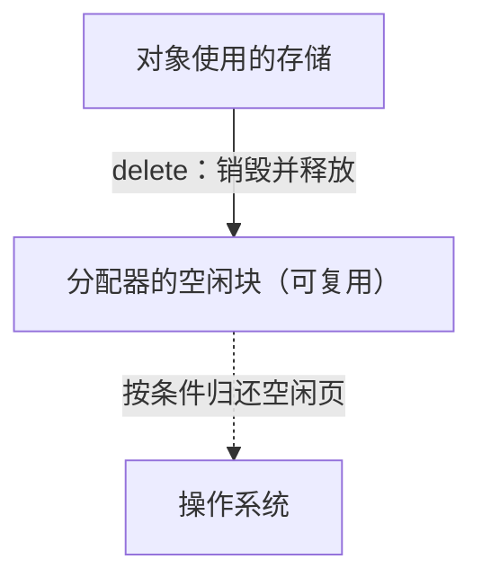

刚学 C++ 时，我也背过那张“五区图”：代码区、常量区、全局区、堆区、栈区。但写到 `std::vector` 就有点解释不通了：局部变量在栈上，它为什么能装下几百万个元素？函数返回后，这些元素又是谁释放的？

要回答这件事，先把**对象本身、它管理的数据、它们各自能活多久**分开。内存区的名字才会和实际代码对应起来。

## 先看内存区的整体分工

程序运行时，机器指令、长期保存的数据、函数调用中的临时状态，需要不同的存放和管理方式。下面按 Linux 常见实现画一张地图；它表示进程的**虚拟地址空间**，区域不按比例，也不一定紧挨着。

```render html title="一种常见布局。右侧说明用途，纵向只表示地址的大致次序。"
<style>
  .address-map { display: grid; grid-template-columns: 22px minmax(0, 1fr); gap: 14px; padding-block: 8px; }
  .address-axis { display: flex; flex-direction: column; align-items: center; gap: 10px; color: var(--muted); font-size: 13px; line-height: 1.4; }
  .address-axis span { writing-mode: vertical-rl; white-space: nowrap; }
  .address-axis i { flex: 1; width: 1px; min-height: 60px; background: var(--rule); }
  .address-regions { display: grid; gap: 8px; }
  .address-region { display: grid; grid-template-columns: minmax(124px, 0.85fr) minmax(0, 1.4fr); align-items: center; gap: 16px; padding: 13px 16px; border-left: 3px solid var(--rule); background: color-mix(in srgb, var(--rule) 18%, transparent); }
  .address-region.is-writable { border-left-color: var(--accent); }
  .address-region.is-mapping { margin-block: 6px; border: 1px dashed var(--rule); background: transparent; }
  .address-region strong { display: block; font-size: 16px; font-weight: 600; }
  .address-region small { display: block; margin-top: 2px; color: var(--muted); font: 12px/1.6 var(--font-mono); }
  .address-region p { margin: 0; font-size: 14px; line-height: 1.75; }
  @media (max-width: 440px) {
    .address-map { gap: 8px; }
    .address-region { grid-template-columns: 1fr; gap: 5px; padding: 12px; }
    .address-region small { display: inline; margin-left: 8px; }
    .address-region strong { display: inline; }
  }
</style>
<div class="address-map" role="img" aria-label="从高地址到低地址，示意栈、其他映射、堆、可写静态数据、只读数据和代码的常见布局">
  <div class="address-axis" aria-hidden="true"><span>高地址</span><i></i><span>低地址</span></div>
  <div class="address-regions">
    <div class="address-region is-writable"><div><strong>栈</strong><small>通常可读写</small></div><p>保存函数调用现场和需要放进内存的局部对象。</p></div>
    <div class="address-region is-mapping"><div><strong>其他映射</strong><small>权限依用途而定</small></div><p>动态库、文件、线程栈；动态分配也可能来自这里。</p></div>
    <div class="address-region is-writable"><div><strong>堆</strong><small>通常可读写</small></div><p>分配器管理存储，让对象可以独立于某次调用存在。</p></div>
    <div class="address-region is-writable"><div><strong>可写静态数据</strong><small>.data / .bss</small></div><p>全局变量、局部 static 等长期保留的数据。</p></div>
    <div class="address-region"><div><strong>只读数据</strong><small>常见于 .rodata</small></div><p>字符串字面量等不允许修改的数据。</p></div>
    <div class="address-region"><div><strong>代码</strong><small>常见于 .text</small></div><p>编译后的机器指令，通常可读、可执行。</p></div>
  </div>
</div>
```

“虚拟”可以先这样理解：指针里的地址是进程看到的编号，操作系统通过页表把它对应到物理内存。**虚拟地址连续，物理页可以分散**；不同进程也可以看到相同的地址编号，背后却是不同的内存。

这张图描述常见实现。C++ 规定的是对象的存储期和生命周期，并不要求内存固定分成五块。编译器也可以把局部值放进寄存器，甚至直接算出结果、消掉存储。后面说“在栈上”，都按通常需要实际存储的情况理解。

## 跟着一个函数看：对象和数据各在哪

先只看这几行，假设使用默认分配器：

```cpp
void work() {
    int count = 3;
    static int calls = 0;
    ++calls;
    std::vector<int> values(count, 7);
}
```

`count` 是普通局部对象，这次调用结束就消失。`calls` 虽然也写在函数里，却由 `static` 指定了静态存储期：函数返回后仍然保留，下次调用接着累加。**名字在哪些地方能用，是作用域；存储保留多久，是存储期。** 写在同一个函数里，不代表两者相同。

`values` 要拆成两部分看。vector 对象本身保存元素地址、大小、容量等管理信息，是一个局部对象；三个整数则放在它另外申请的动态存储里。于是，局部 vector 可以很小，同时管理一大片元素。`sizeof(values)` 也只计算 vector 自身，不包含那片元素存储。

下面从第一次调用即将返回的位置开始。点“函数返回”，看看哪些对象消失，哪些状态留下来。

```render html title="示意默认分配器下的存储关系，不代表 vector 的具体内部布局。"
<style>
  .lifetime-lab { padding-block: 8px; }
  .lifetime-heading { display: flex; flex-wrap: wrap; justify-content: space-between; gap: 6px 16px; align-items: baseline; margin-bottom: 18px; }
  .lifetime-heading strong { font-size: 17px; font-weight: 600; }
  .lifetime-heading span { color: var(--muted); font-size: 14px; }
  .lifetime-scene { display: grid; grid-template-columns: minmax(0, 1fr) 44px minmax(0, 1fr); align-items: center; }
  .lifetime-place { align-self: stretch; min-width: 0; }
  .lifetime-place h3 { margin: 0 0 10px; color: var(--muted); font-size: 14px; font-weight: 500; }
  .lifetime-object { display: flex; flex-direction: column; justify-content: center; gap: 12px; min-height: 132px; padding: 16px; border: 1px solid var(--accent); background: var(--accent-soft); }
  .lifetime-object code { font-size: 15px; }
  .lifetime-object small { color: var(--muted); font-size: 13px; line-height: 1.7; }
  .lifetime-elements { display: flex; gap: 6px; }
  .lifetime-elements span { display: grid; place-items: center; flex: 1; min-height: 38px; border: 1px solid var(--rule); font: 16px var(--font-mono); }
  .lifetime-link { align-self: center; padding-top: 30px; color: var(--accent-ink); font-size: 26px; text-align: center; }
  .lifetime-static { display: flex; flex-wrap: wrap; gap: 6px 18px; align-items: baseline; margin-top: 20px; padding-block: 12px; border-block: 1px solid var(--rule); font-size: 14px; }
  .lifetime-static span { color: var(--muted); }
  .lifetime-static code { font-size: 15px; }
  .lifetime-controls { display: flex; flex-wrap: wrap; gap: 10px; margin-top: 18px; }
  .lifetime-controls button { min-height: 44px; padding: 7px 16px; border: 1px solid var(--rule); border-radius: 4px; background: transparent; font-size: 15px; cursor: pointer; }
  .lifetime-controls .lifetime-next { border-color: var(--accent); background: var(--accent-soft); color: var(--accent-ink); }
  .lifetime-note { display: block; min-height: 3.6em; margin-top: 14px; font-size: 14px; line-height: 1.8; }
  .lifetime-lab[data-returned="true"] .lifetime-object { border: 1px dashed var(--rule); background: transparent; }
  .lifetime-lab[data-returned="true"] .lifetime-link { visibility: hidden; }
  @media (max-width: 480px) {
    .lifetime-scene { grid-template-columns: 1fr; gap: 10px; }
    .lifetime-link { padding-top: 0; line-height: 1; transform: rotate(90deg); }
    .lifetime-object { min-height: 112px; }
    .lifetime-note { min-height: 5.4em; }
  }
</style>
<section class="lifetime-lab" data-returned="false" aria-label="局部 vector、动态元素和静态变量的生命周期演示">
  <div class="lifetime-heading"><strong>第 <span class="lifetime-call">1</span> 次调用 work()</strong><span class="lifetime-phase">即将返回</span></div>
  <div class="lifetime-scene">
    <div class="lifetime-place">
      <h3>自动存储 · 通常在栈上</h3>
      <div class="lifetime-object lifetime-local"><code>count = 3</code><code>values → 三个元素</code><small>两个局部对象都还活着</small></div>
    </div>
    <div class="lifetime-link" aria-hidden="true">→</div>
    <div class="lifetime-place">
      <h3>动态存储 · 由 values 管理</h3>
      <div class="lifetime-object lifetime-dynamic"><div class="lifetime-elements"><span>7</span><span>7</span><span>7</span></div><small>三个 int 元素都还活着</small></div>
    </div>
  </div>
  <div class="lifetime-static"><span>静态存储 · 不随本次调用结束</span><code>calls = <b class="lifetime-count">1</b></code></div>
  <div class="lifetime-controls"><button type="button" class="lifetime-next">函数返回</button><button type="button" class="lifetime-reset">重置</button></div>
  <output class="lifetime-note" aria-live="polite">values 自身和三个元素在不同的存储中，由 values 负责管理这片元素存储。</output>
</section>
<script>
  const lab = document.querySelector('.lifetime-lab');
  const local = document.querySelector('.lifetime-local');
  const dynamic = document.querySelector('.lifetime-dynamic');
  const next = document.querySelector('.lifetime-next');
  const note = document.querySelector('.lifetime-note');
  let calls = 1;
  let returned = false;

  function refresh() {
    lab.dataset.returned = String(returned);
    document.querySelector('.lifetime-call').textContent = calls;
    document.querySelector('.lifetime-count').textContent = calls;
    document.querySelector('.lifetime-phase').textContent = returned ? '已经返回' : '即将返回';
    next.textContent = returned ? '再次调用' : '函数返回';
    local.innerHTML = returned
      ? '<strong>局部对象已销毁</strong><small>栈空间可以被后续调用复用</small>'
      : '<code>count = 3</code><code>values → 三个元素</code><small>两个局部对象都还活着</small>';
    dynamic.innerHTML = returned
      ? '<strong>元素生命周期已结束</strong><small>存储已归还分配器，可以再次分配</small>'
      : '<div class="lifetime-elements"><span>7</span><span>7</span><span>7</span></div><small>三个 int 元素都还活着</small>';
    note.textContent = returned
      ? 'values 的析构函数结束元素的生命周期并释放元素存储。calls 保留当前值；释放不要求把旧字节清零。'
      : calls === 1
        ? 'values 自身和三个元素在不同的存储中，由 values 负责管理这片元素存储。'
        : '本次重新创建 count、values 和元素；calls 沿用上一回的值再加一。地址即使被复用，局部对象也是新的一批。';
  }

  next.addEventListener('click', () => {
    if (returned) calls += 1;
    returned = !returned;
    refresh();
  });
  document.querySelector('.lifetime-reset').addEventListener('click', () => {
    calls = 1;
    returned = false;
    refresh();
  });
</script>
```

这也解释了“堆上的数据怎么自动释放”：函数返回时，局部 `values` 会析构，它的析构函数再结束元素的生命周期、归还元素存储。**自动清理来自拥有者的析构，和数据是否位于堆上是两回事。**

这里用到的就是 RAII：让一个对象拥有资源，在它析构时释放资源。vector 管理元素存储，`std::unique_ptr` 管理它拥有的动态对象。正常离开作用域，或异常传播导致栈展开时，已经构造完成的局部拥有者都会按规则清理资源。

## 栈和堆，差在怎样安排生存时间

栈很适合普通的嵌套调用：`main` 调用 `f`，`f` 调用 `g`，返回时按 `g → f → main` 恢复现场。每次调用占用的一片空间叫**栈帧**。存储按这个顺序成批回收，通常调整栈指针就能完成，所以管理开销低；类对象的析构仍然要执行。

但连接、任务、图片缓存可能以 A、B、C 的顺序创建，再以 B、A、C 的顺序结束，也可能在创建它们的函数返回后继续使用。动态存储允许分别安排这些对象的寿命。普通 `new T(...)` 取得存储并初始化对象，`delete p` 销毁对象并归还存储；日常代码通常用容器或智能指针承接这份所有权。

因此，“堆”不意味着“永远不自动释放”，“栈”也不意味着“所有读写都更快”。前者需要找到负责清理的拥有者；后者的优势主要在分配和回收方式，实际访问速度还取决于缓存和数据布局。

### 字节还在，不代表对象还活着

```cpp
int* bad() {
    int value = 42;
    return &value;
}
```

`value` 在函数返回时结束生命周期。返回的指针不会延长它的寿命，继续读取它是未定义行为：语言不再保证程序会怎样运行，即使这次碰巧读到了 42。

回收栈空间通常不需要清零，旧字节可能暂时留着，随后被别的调用覆盖。**访问是否有效，要看对象是否仍然存在，不能看旧内容还在不在。** 这个函数只需返回 `int` 值；如果是一组数据，就返回拥有数据的 vector。返回它的 `data()` 裸指针没有同样的效果，因为裸指针不拥有元素。

## static 和 const，各自管什么

`static` 出现在局部声明里，会让对象的存储跨调用保留，前面的 `calls` 就是这样。需要运行构造逻辑的局部静态对象，在第一次执行到声明时初始化；这不表示每次调用都重新构造。普通全局对象也具有静态存储期，`thread_local` 则是每个线程一份，存储持续到对应线程结束。

在常见的可执行文件布局里，带非零初值的可写静态数据常放在 `.data`，零初始化数据常放在 `.bss`。后者只需在文件中记录所需大小，装载时提供清零的存储，不必把所有零逐个存进文件。**全局的 `int n;` 会初始化为 0，函数里的普通 `int n;` 则没有可直接读取的初值。**

`const` 管的是修改约束，不能单凭它判断内存位置。局部 `const int` 仍可以是自动存储期对象；通过 `new const int(3)` 创建的对象则具有动态存储期。字符串也要分清指针和字符：

```cpp
const char* p = "hello";
char a[] = "hello";
a[0] = 'H';
```

假设这几行写在函数里，`p` 是局部指针，指向具有静态存储期的字符串字面量，不能修改字面量里的字符；`a` 是局部数组，自己含有六个字符（包括结尾的 `\0`），所以能修改自己的那份副本。`p` 指向长期存在的数据，不会让指针变量本身也变成静态对象。

## delete 以后，为什么进程占用可能没降

可以把内存管理看成三层：程序里的对象、管理空闲块的分配器、提供内存页的操作系统。



分配器通常先向系统取得较大的空间，再切成小块交给程序，因此每次 `new` 不一定都要找操作系统。`delete` 之后，这块空间可以先留在分配器里，供下次使用。如果同一页上还有活对象，也不能直接把整页归还。

所以要区分两个问题：**对象是否已经销毁，物理内存是否已经交还。** 进程的 RSS 大致反映当前驻留在物理内存中的页面，并不等于所有活对象大小之和。仅凭一次释放后 RSS 没下降，不能判断泄漏；应该继续找是否还有拥有者持有数据，以及分配器是否保留了空闲空间。

## 写代码时，按什么顺序选

我会先问：谁拥有数据，要活多久，然后再看规模。

| 需求 | 通常先选 | 对应的存储关系 |
| --- | --- | --- |
| 当前作用域内的小对象 | 普通局部值、`std::array` | 数组元素直接包含在对象里，随对象结束 |
| 很大或运行时才知道大小的连续数据 | `std::vector` | 对象管理另一片元素存储，析构时释放 |
| 单个对象需要独立生存、转交所有权 | 合适时用 `std::unique_ptr` | 拥有者可以移动，负责销毁动态对象 |
| 确实要在多次调用间保留状态 | 全局或局部 `static` | 存储长期保留，也要考虑共享状态 |

例如，大数组放进局部变量可能耗尽线程栈，改用 vector 可以改变元素存储的来源。但它不会减少元素需要的总字节数，也不会修复悬空指针。

再遇到“这个变量在哪个区”，先找清楚它指的是**对象本身，还是它指向的数据**；再沿着拥有关系，找到最后负责销毁它的人。这样再去看那张内存地图，就有落点了。

## 参考资料

- C++ 工作草案：[存储期](https://eel.is/c++draft/basic.stc)、[对象生命周期](https://eel.is/c++draft/basic.life)、[局部变量与初始化](https://eel.is/c++draft/stmt.dcl)。核对对象能活多久，以及作用域退出时发生什么；本文示例按 `C++20` 理解。
- C++ 工作草案：[new 表达式](https://eel.is/c++draft/expr.new)、[delete 表达式](https://eel.is/c++draft/expr.delete)、[vector 的容量与数据访问](https://eel.is/c++draft/vector.capacity)。区分对象自身与它管理的存储。
- ELF gABI：[程序装载](https://gabi.xinuos.com/elf/07-pheader.html)。文件中的数据怎样进入进程，零初始化空间为什么不必占用同样大的文件体积。
- Linux 文档：[/proc 文件系统](https://docs.kernel.org/filesystems/proc.html)、[malloc_trim(3)](https://man7.org/linux/man-pages/man3/malloc_trim.3.html)。对照进程内存统计与分配器归还空闲页的行为。
