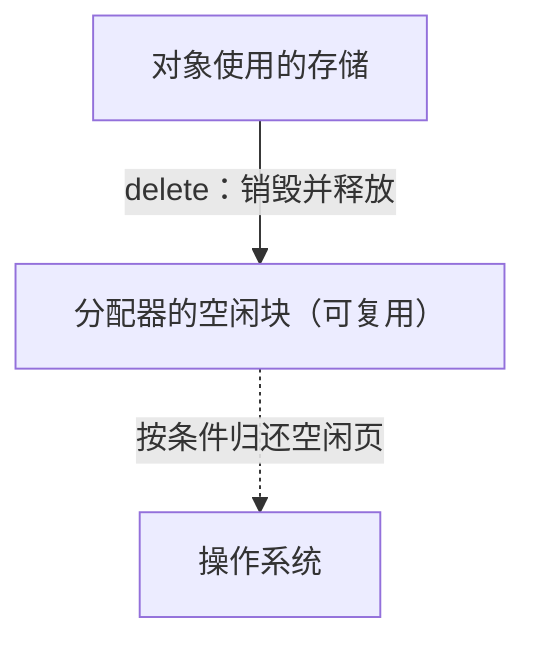

局部 `std::vector` 为什么能装下几百万个元素，又能在函数返回时自动释放？先分清**对象本身、它管理的数据，以及谁负责销毁它们**。

## 先看内存区的整体分工

下面按 Linux 常见实现画出虚拟地址空间：指针中的地址是进程看到的编号，不是物理内存条的位置。

```render html title="常见虚拟地址布局示意，区域不按比例。页表再把这些地址映射到物理页。"
<style>
  .memory-map svg { display: block; width: 100%; }
</style>
<div class="memory-map" aria-label="进程虚拟地址空间"></div>
<script>
  const scene = document.querySelector('.memory-map');
  function draw() {
    const w = scene.clientWidth, narrow = w < 430, x = narrow ? 22 : 100, width = narrow ? 116 : 200, label = x+width+24;
    const regions = [
      {y:40,h:58,name:'栈',detail:'局部对象',tone:'var(--accent)'},
      {y:118,h:42,name:'其他映射',detail:'动态库、文件'},
      {y:180,h:72,name:'堆',detail:'动态分配',tone:'var(--accent)'},
      {y:276,h:54,name:'.data / .bss',detail:'全局 / static'},
      {y:330,h:48,name:'.rodata',detail:'字符串字面量'},
      {y:378,h:48,name:'.text',detail:'机器指令'}
    ];
    scene.innerHTML = `<svg viewBox="0 0 ${w} 466" role="img" aria-label="高地址一侧为栈，中间有映射和堆，低地址一侧有静态数据、只读数据和代码">
      <text x="${x}" y="17" fill="var(--muted)" font-size="12">高地址</text><text x="${x}" y="451" fill="var(--muted)" font-size="12">低地址</text>
      <path d="M${x-12} 36V426" stroke="var(--rule-strong)"/>
      ${regions.map(r => `<rect x="${x}" y="${r.y}" width="${width}" height="${r.h}" fill="${r.tone||'var(--rule)'}" fill-opacity="${r.tone?'.12':'.24'}" stroke="${r.tone||'var(--rule-strong)'}" ${r.name==='其他映射'?'stroke-dasharray="4 4"':''}/><text x="${x+width/2}" y="${r.y+r.h/2+5}" text-anchor="middle" fill="var(--text)" font-size="${r.name.startsWith('.')?13:16}" font-family="${r.name.startsWith('.')?'var(--font-mono)':'var(--font-sans)'}">${r.name}</text><path d="M${x+width} ${r.y+r.h/2}h16" stroke="var(--rule-strong)"/><text x="${label}" y="${r.y+r.h/2+5}" fill="var(--muted)" font-size="${narrow?12:14}">${r.detail}</text>`).join('')}
      <path d="M${x+width/2} 100v12m-4-4 4 4 4-4M${x+width/2} 178v-12m-4 4 4-4 4 4" fill="none" stroke="var(--accent)" stroke-width="1.5"/>
    </svg>`;
  }
  new ResizeObserver(draw).observe(scene);
</script>
```

C++ 规定存储期与生命周期，不要求固定的五区布局。局部值也可能放在寄存器中或被优化掉；下文按需要实际存储的情况理解。

## 跟着一个函数看：对象和数据各在哪

先只看这几行，假设使用默认分配器：

```cpp
void work() {
    int count = 3;
    static int calls = 0;
    ++calls;
    std::vector<int> values(count, 7);
}
```

`count`、`values` 每次调用重新创建，`calls` 跨调用保留。vector 自身只存管理信息，元素另行分配；`sizeof(values)` 不包含那片元素。拖动时间轴查看各个阶段，或点“函数返回”看清理过程：

```render html
<style>
  .life-score { --blue: #356f9b; --amber: #ae622f; --amber-soft: #f0dfc9; position: relative; padding: 12px 0 4px; }
  :root[data-theme="dark"] .life-score { --blue: #95bfdc; --amber: #e3ad77; --amber-soft: #3e3022; }
  .score-scene { --score-ink: var(--text); --score-blue: var(--blue); position: relative; }
  .life-score[data-ended="true"] .score-scene { --score-ink: var(--rule-strong); --score-blue: var(--rule-strong); }
  .life-score[data-ended="true"] .score-wash { opacity: .35; }
  .score-present { will-change: transform; }
  .score-scene svg { display: block; width: 100%; overflow: visible; }
  .score-scene text { dominant-baseline: middle; font-family: var(--font-mono); }
  .score-name { fill: var(--text); font-size: 14px; }
  .score-region { fill: var(--muted); font-family: var(--font-sans) !important; font-size: 12px; letter-spacing: 2px; text-anchor: middle; }
  .score-scrub { position: absolute; top: 35px; height: 44px; margin: 0; padding: 0; appearance: none; background: transparent; cursor: ew-resize; }
  .score-scrub::-webkit-slider-runnable-track { height: 1px; background: transparent; }
  .score-scrub::-webkit-slider-thumb { appearance: none; width: 14px; height: 22px; margin-top: -11px; border: 1px solid var(--text); border-radius: 4px; background: linear-gradient(90deg, transparent 5px, var(--rule-strong) 5px, var(--rule-strong) 7px, transparent 7px), var(--bg-raised); box-shadow: 0 2px 4px rgb(0 0 0 / .08); }
  .score-scrub::-moz-range-track { height: 1px; background: transparent; }
  .score-scrub::-moz-range-thumb { width: 12px; height: 20px; border: 1px solid var(--text); border-radius: 4px; background: var(--bg-raised); }
  .score-scrub:focus-visible { outline-offset: 5px; }
  .score-controls { display: flex; justify-content: flex-end; align-items: center; gap: 14px; margin-top: 8px; padding-right: 12px; }
  .score-controls button { display: inline-flex; justify-content: center; align-items: center; min-height: 44px; border: 0; background: transparent; cursor: pointer; }
  .score-next { gap: 12px; padding: 0 0 0 12px; font-size: 13px; }
  .score-next svg { width: 36px; height: 32px; padding: 8px; border: 1px solid var(--rule-strong); border-radius: 5px; background: var(--bg-raised); box-shadow: 0 2px 0 var(--rule); }
  .score-next:hover svg { border-color: var(--text); }
  .score-reset { width: 44px; padding: 0; color: var(--muted); }
  .score-reset svg { width: 15px; height: 15px; }
  .score-controls button:disabled { cursor: default; opacity: .5; }
  .score-sr { position: absolute; width: 1px; height: 1px; padding: 0; overflow: hidden; clip-path: inset(50%); white-space: nowrap; }
</style>
<section class="life-score" aria-label="拖动时间切面，观察对象的生命线">
  <div class="score-scene"></div>
  <input class="score-scrub" type="range" min="0" max="1000" step="1" value="620" aria-label="函数调用时间" />
  <div class="score-controls">
    <button class="score-reset" type="button" aria-label="重置演示" title="重置"><svg viewBox="0 0 16 16" aria-hidden="true"><path d="M3 5a5.5 5.5 0 1 1-1 5M3 1v4h4" fill="none" stroke="currentColor" stroke-width="1.3" stroke-linecap="round" stroke-linejoin="round"/></svg></button>
    <button class="score-next" type="button"><span>函数返回</span><svg viewBox="0 0 16 16" aria-hidden="true"><path d="M13 3v6H3m4-4L3 9l4 4" fill="none" stroke="currentColor" stroke-width="1.4" stroke-linecap="round" stroke-linejoin="round"/></svg></button>
  </div>
  <output class="score-sr" aria-live="polite"></output>
</section>
<script>
  const lab = document.querySelector('.life-score');
  const scene = lab.querySelector('.score-scene');
  const scrub = lab.querySelector('.score-scrub');
  const next = lab.querySelector('.score-next');
  const reset = lab.querySelector('.score-reset');
  const actionLabel = next.querySelector('span'), actionIcon = next.querySelector('path');
  let invocation = 1, time = .62, width = 0, start, span, nodes, stateKey = '', inputFrame = 0;
  function layout(w) {
    width = w;
    const narrow = w < 500, end = w - 22;
    start = narrow ? 98 : 154;
    span = end - start;
    const at = t => start + span * t;
    const cut = at(.8), countBorn = at(.06), valuesBorn = at(.24), elementsBorn = at(.32);
    const tracks = `<path d="M${countBorn} 104H${cut-10}" stroke="var(--score-ink)" stroke-width="2"/>
      <path d="M${valuesBorn} 153H${cut-10}" stroke="var(--score-blue)" stroke-width="3"/>
      ${[211,233,255].map(y=>`<path d="M${elementsBorn} ${y}H${cut-10}" stroke="var(--score-blue)" stroke-width="1.5"/>`).join('')}`;
    const bead = (y,label,tone) => `<circle cy="${y}" r="12" fill="var(--bg)"/><text y="${y+1}" fill="${tone}" font-size="16" text-anchor="middle">${label}</text>`;
    scene.innerHTML = `<svg viewBox="0 0 ${w} 356" role="img">
      <defs>
        <linearGradient id="call-wash" x1="0" x2="1"><stop stop-color="var(--surface)" stop-opacity=".3"/><stop offset="1" stop-color="var(--surface)" stop-opacity=".65"/></linearGradient>
        <clipPath id="score-past"><rect class="score-clip" x="${start-12}" y="70" width="0" height="282"/></clipPath>
      </defs>
      <path class="score-wash" d="M${start-12} 67H${cut-10}V282H${start-12}Z" fill="url(#call-wash)"/>
      <text x="${start-12}" y="17" fill="var(--text)" font-size="${narrow?13:16}">work()<tspan class="score-invocation" dx="8" fill="var(--muted)" font-size="12"></tspan></text>
      <path d="M${start-12} 45H${end+8}m-4-3 4 3-4 3" fill="none" stroke="var(--rule-strong)"/>
      ${Array.from({length:9},(_,i)=>`<path d="M${at(i/10)} 42v6" stroke="var(--rule-strong)"/>`).join('')}
      <text x="${cut+4}" y="17" fill="var(--muted)" font-size="12" text-anchor="middle">return</text>
      <path d="M${cut-1} 70q12 0 12 14v68q0 17 12 17-12 0-12 17v80q0 14-12 14" fill="none" stroke="var(--rule-strong)" stroke-width="1.4"/>
      <path d="M${cut+11} 293v47" stroke="var(--rule-strong)" stroke-dasharray="2 5"/>
      <path d="M19 88h-5v75h5M19 201h-5v64h5M19 309h-5v26h5" fill="none" stroke="var(--rule-strong)"/>
      <text class="score-region" x="8" y="125" transform="rotate(-90 8 125)">栈</text>
      <text class="score-region" x="8" y="233" transform="rotate(-90 8 233)">动态</text>
      <text class="score-region" x="8" y="322" transform="rotate(-90 8 322)">静态</text>
      <text class="score-name" x="30" y="104">count</text>
      <text class="score-name" x="30" y="153" style="fill:var(--blue)">values</text>
      <text class="score-name" x="30" y="233" style="fill:var(--blue)">元素</text>
      <g fill="none" stroke-linecap="round">
        <g opacity=".12">${tracks}</g>
        <g clip-path="url(#score-past)">
          ${tracks}
          <circle cx="${countBorn}" cy="104" r="3" fill="var(--score-ink)"/>
          <circle cx="${valuesBorn}" cy="153" r="3" fill="var(--score-blue)"/>
          <path class="score-fork" d="M${valuesBorn+3} 153v63q0 17 12 17h${Math.max(0,elementsBorn-valuesBorn-15)}M${elementsBorn-5} 211v44${[211,233,255].map(y=>`M${elementsBorn-5} ${y}h5`).join('')}" stroke="var(--score-blue)" stroke-width="1.2" opacity=".6"/>
          <path d="M${start-12} 322H${end}" stroke="var(--amber)" stroke-width="2.5"/>
        </g>
      </g>
      <g class="score-ends" fill="var(--bg)" stroke="var(--rule-strong)">${[104,153,211,233,255].map(y=>`<circle cx="${cut-10}" cy="${y}" r="3"/>`).join('')}</g>
      <text class="score-name" x="30" y="322" style="fill:var(--amber)">calls</text>
      <path d="M${start-12} 322H${end+8}m-4-3 4 3-4 3" stroke="var(--amber)" fill="none" stroke-width="1.5" opacity=".3"/>
      <g class="score-previous"><circle cx="${start-5}" cy="322" r="9" fill="var(--bg)"/><text class="score-previous-value" x="${start-5}" y="323" fill="var(--amber)" font-size="12" text-anchor="middle"></text></g>
      <g class="score-present">
        <path d="M0 58V341" stroke="var(--text)" stroke-width="1" opacity=".22"/>
        <g class="score-count">${bead(104,3,'var(--text)')}</g>
        <circle class="score-values" cy="153" r="5" fill="var(--blue)"/>
        <g class="score-elements">${[211,233,255].map(y=>bead(y,7,'var(--blue)')).join('')}</g>
        <circle cy="322" r="16" fill="var(--amber-soft)" stroke="var(--amber)"/>
        <text class="score-call-value" y="323" fill="var(--amber)" font-size="19" text-anchor="middle"></text>
      </g>
    </svg>`;
    nodes = Object.fromEntries(['clip','present','count','values','elements','fork','ends','previous','previous-value','call-value','invocation'].map(name=>[name,scene.querySelector('.score-'+name)]));
    nodes.svg = scene.querySelector('svg');
    scrub.style.left = `${start-7}px`;
    scrub.style.width = `${span+14}px`;
    stateKey = '';
    update();
  }
  function update() {
    const now = start + span*time, dead = time >= .8;
    const calls = invocation - (time < .16 ? 1 : 0);
    nodes.present.style.transform = `translate3d(${now}px,0,0)`;
    nodes.clip.setAttribute('width', now-start+12);
    scrub.value = Math.round(time*1000);
    const phase = `${invocation}:${calls}:${time>=.06}:${time>=.24}:${time>=.32}:${dead}`;
    if (phase === stateKey) return;
    stateKey = phase;
    lab.dataset.ended = String(dead);
    nodes.count.style.visibility = !dead && time>=.06 ? 'visible' : 'hidden';
    nodes.values.style.visibility = !dead && time>=.24 ? 'visible' : 'hidden';
    nodes.elements.style.visibility = !dead && time>=.32 ? 'visible' : 'hidden';
    nodes.fork.style.visibility = time>=.24 ? 'visible' : 'hidden';
    nodes.ends.style.visibility = dead ? 'visible' : 'hidden';
    nodes.previous.style.visibility = invocation>1 ? 'visible' : 'hidden';
    nodes['previous-value'].textContent = invocation-1;
    nodes['call-value'].textContent = calls;
    nodes.invocation.textContent = '#'+invocation;
    nodes.svg.setAttribute('aria-label', `第 ${invocation} 次 work 调用；${dead?'局部对象与元素的生命线止于返回处，':'函数尚未返回，'}calls 为 ${calls}，跨调用保留`);
    scrub.setAttribute('aria-valuetext', `第 ${invocation} 次调用，${dead?'返回后':'调用中'}，calls = ${calls}`);
    actionLabel.textContent = dead ? '再次调用' : '函数返回';
    actionIcon.setAttribute('d', dead ? 'M4 3l9 5-9 5Z' : 'M13 3v6H3m4-4L3 9l4 4');
  }
  function announce() {
    lab.querySelector('output').textContent = scrub.getAttribute('aria-valuetext');
  }
  function animate(to) {
    const from = time, began = performance.now(), duration = matchMedia('(prefers-reduced-motion: reduce)').matches ? 0 : 900;
    next.disabled = reset.disabled = scrub.disabled = true;
    function frame(now) {
      const p = duration ? Math.min(1,(now-began)/duration) : 1;
      time = from + (to-from)*(p*p*(3-2*p));
      update();
      if (p<1) requestAnimationFrame(frame);
      else { next.disabled = reset.disabled = scrub.disabled = false; announce(); }
    }
    requestAnimationFrame(frame);
  }
  next.addEventListener('click', () => {
    if (time >= .8) { invocation++; time = 0; animate(.62); }
    else animate(1);
  });
  scrub.addEventListener('input', () => {
    time = Number(scrub.value)/1000;
    if (inputFrame) return;
    inputFrame = requestAnimationFrame(() => { inputFrame = 0; update(); });
  });
  reset.addEventListener('click', () => { invocation = 1; time = .62; update(); announce(); });
  new ResizeObserver(([entry]) => {
    if (entry.contentRect.width !== width) layout(entry.contentRect.width);
  }).observe(scene);
</script>
```

这就是 **RAII**：让对象拥有资源，在析构时释放。正常离开作用域，或异常传播引起栈展开时，已构造完成的局部拥有者都会按规则清理资源；数据放在堆上也能自动释放。

## 栈和堆，差在怎样安排生存时间

栈很适合普通的嵌套调用：`main` 调用 `f`，`f` 调用 `g`，返回时按 `g → f → main` 恢复现场。每次调用占用的一片空间叫**栈帧**。存储按这个顺序成批回收，通常调整栈指针就能完成，所以管理开销低；类对象的析构仍然要执行。

但连接、任务、图片缓存可能以 A、B、C 的顺序创建，再以 B、A、C 的顺序结束，也可能在创建它们的函数返回后继续使用。动态存储允许分别安排这些对象的寿命。普通 `new T(...)` 取得存储并初始化对象，`delete p` 销毁对象并归还存储；日常代码通常用容器或智能指针承接这份所有权。

因此，“堆”不意味着“永远不自动释放”，“栈”也不意味着“所有读写都更快”。前者需要找到负责清理的拥有者；后者的优势主要在分配和回收方式，实际访问速度还取决于缓存和数据布局。

### 字节还在，不代表对象还活着

```cpp
int* bad() {
    int value = 42;
    return &value;
}
```

`value` 在函数返回时结束生命周期。返回的指针不会延长它的寿命，继续读取它是未定义行为：语言不再保证程序会怎样运行，即使这次碰巧读到了 42。

回收不要求清零。旧字节还在，也不能延长对象寿命。这里应返回 `int` 值；一组数据可以返回拥有元素的 vector，返回 `data()` 裸指针则不行。

## static 和 const，各自管什么

`static` 出现在局部声明里，会让对象的存储跨调用保留，前面的 `calls` 就是这样。需要运行构造逻辑的局部静态对象，在第一次执行到声明时初始化；这不表示每次调用都重新构造。普通全局对象也具有静态存储期，`thread_local` 则是每个线程一份，存储持续到对应线程结束。

在常见的可执行文件布局里，带非零初值的可写静态数据常放在 `.data`，零初始化数据常放在 `.bss`。后者只需在文件中记录所需大小，装载时提供清零的存储，不必把所有零逐个存进文件。**全局的 `int n;` 会初始化为 0，函数里的普通 `int n;` 则没有可直接读取的初值。**

`const` 管的是修改约束，不能单凭它判断内存位置。局部 `const int` 仍可以是自动存储期对象；通过 `new const int(3)` 创建的对象则具有动态存储期。字符串也要分清指针和字符：

```cpp
const char* p = "hello";
char a[] = "hello";
a[0] = 'H';
```

假设这几行写在函数里，`p` 是局部指针，指向具有静态存储期的字符串字面量，不能修改字面量里的字符；`a` 是局部数组，自己含有六个字符（包括结尾的 `\0`），所以能修改自己的那份副本。`p` 指向长期存在的数据，不会让指针变量本身也变成静态对象。

## delete 以后，为什么进程占用可能没降

可以把内存管理看成三层：程序里的对象、管理空闲块的分配器、提供内存页的操作系统。



分配器通常先向系统取得较大的空间，再切成小块交给程序，因此每次 `new` 不一定都要找操作系统。`delete` 之后，这块空间可以先留在分配器里，供下次使用。如果同一页上还有活对象，也不能直接把整页归还。

所以要区分两个问题：**对象是否已经销毁，物理内存是否已经交还。** 进程的 RSS 大致反映当前驻留在物理内存中的页面，并不等于所有活对象大小之和。仅凭一次释放后 RSS 没下降，不能判断泄漏；应该继续找是否还有拥有者持有数据，以及分配器是否保留了空闲空间。

## 写代码时，按什么顺序选

我会先问：谁拥有数据，要活多久，然后再看规模。

| 需求 | 通常先选 | 对应的存储关系 |
| --- | --- | --- |
| 当前作用域内的小对象 | 普通局部值、`std::array` | 数组元素直接包含在对象里，随对象结束 |
| 很大或运行时才知道大小的连续数据 | `std::vector` | 对象管理另一片元素存储，析构时释放 |
| 单个对象需要独立生存、转交所有权 | 合适时用 `std::unique_ptr` | 拥有者可以移动，负责销毁动态对象 |
| 确实要在多次调用间保留状态 | 全局或局部 `static` | 存储长期保留，也要考虑共享状态 |

例如，大数组放进局部变量可能耗尽线程栈，改用 vector 可以改变元素存储的来源。但它不会减少元素需要的总字节数，也不会修复悬空指针。

## 参考资料

- C++ 工作草案：[存储期](https://eel.is/c++draft/basic.stc)、[对象生命周期](https://eel.is/c++draft/basic.life)、[局部变量与初始化](https://eel.is/c++draft/stmt.dcl)。核对对象能活多久，以及作用域退出时发生什么；本文示例按 `C++20` 理解。
- C++ 工作草案：[new 表达式](https://eel.is/c++draft/expr.new)、[delete 表达式](https://eel.is/c++draft/expr.delete)、[vector 的容量与数据访问](https://eel.is/c++draft/vector.capacity)。区分对象自身与它管理的存储。
- ELF gABI：[程序装载](https://gabi.xinuos.com/elf/07-pheader.html)。文件中的数据怎样进入进程，零初始化空间为什么不必占用同样大的文件体积。
- Linux 文档：[/proc 文件系统](https://docs.kernel.org/filesystems/proc.html)、[malloc_trim(3)](https://man7.org/linux/man-pages/man3/malloc_trim.3.html)。对照进程内存统计与分配器归还空闲页的行为。
