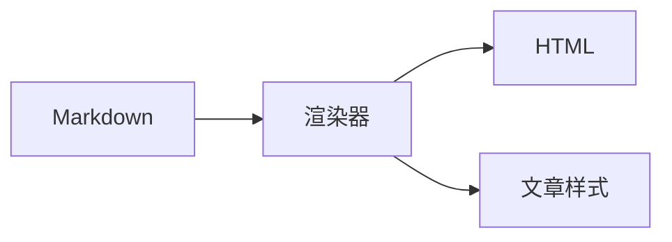

这是一篇写作草稿，可以在本地开发预览中阅读。准备发布时，将文章元数据中的 `draft` 设为 `false`。

## 行内效果与提示框

一段话里可以混用 ==黄色高亮==、++下划线++、~~细删除线~~、`行内代码`，以及 <kbd>Ctrl</kbd> + <kbd>K</kbd> 这样的键帽。

也可以嵌套使用，例如 ==高亮里的 **重点**==，或 ++包含 $a^2+b^2=c^2$ 的下划线++。

正文链接会带有细下划线，例如 [站内标签索引](/tags/) 和 [KaTeX 文档](https://katex.org/docs/supported)。

直接粘贴网址也会自动识别：https://katex.org/docs/supported。

> [!NOTE]
> 说明用来补充背景。正文里的 `const`、数学公式和链接都会沿用文章本身的样式。

> [!TIP]
> 建议适合放写作提醒、阅读路径或一个更省事的做法。

> [!IMPORTANT]
> 重点会被强调色标出来，用来提醒这一段不能略过。

> [!WARNING]
> 警告用于容易出错的操作，比如析构对象后继续访问旧指针。

> [!CAUTION]
> 注意用于低风险但值得留心的边界条件。

<details>
<summary>折叠内容</summary>

`details` 可以收纳较长的补充说明。这里的摘要、图标和展开后的间距都跟随主题。

</details>

## 表情

想在句子里加一点语气，写 `:名字:` 就行，比如 :laugh_cry: 、:thumbs_up: 和 :sleep: 。名字不在 [表情页](/stickers/) 里就原样保留，所以 12:30:45 和 `std::cout` 不会被误认。

单独占一行时，表情会放大：

:love: :cry: :angry:

带配字的梗图比小表情更大，适合当一段话的收尾：:rofl: 想看全部，去 [表情页](/stickers/)。

文章标题和一句话描述里也能用，列表、搜索结果和 RSS 里会自动换成 `[笑哭]` 这样的文字。

## 公式

### 行内公式与上下标

行内公式与正文混排，例如 $E=mc^2$ 和 $\mathbb{R}^{n\times d}$。

行内求和 $\sum_{i=1}^{n} i$ 默认将上下标放在右侧，以保持段落行距。需要放在上下方时，可使用 `\limits`，例如 $\sum\limits_{i=1}^{n} i$。

字母、向量和嵌套下标也可以放在一行里：$x_i^2$、$x_{i_j}$、$\alpha+\beta$、$\mathbf{v}\in\mathbb{R}^3$、$\hat{\theta}$ 和 $\bar{x}$。

### 对齐、矩阵与编号

独立公式可以使用对齐、矩阵、分段函数和手动编号：

$$
\begin{aligned}
f(x)&=x^2+2x+1,\\
f'(x)&=2x+2.
\end{aligned}
$$

$$
A=\begin{bmatrix}1&2\\3&4\end{bmatrix},
\qquad
g(x)=\begin{cases}x,&x\ge0,\\-x,&x<0.\end{cases}
\tag{1}
$$

### arraystretch 与矩阵行距

下面两组矩阵内容相同。第一组使用默认行距，第二组通过 `\def\arraystretch{1.7}` 增加行距；设置只在当前这一组公式内生效。

默认行距：

$$
A=\begin{bmatrix}
1 & \frac{1}{2} & 0 \\
0 & 1 & \frac{1}{3} \\
\frac{1}{4} & 0 & 1
\end{bmatrix}
$$

1.7 倍行距：

$$
{\def\arraystretch{1.7}
A=\begin{bmatrix}
1 & \frac{1}{2} & 0 \\
0 & 1 & \frac{1}{3} \\
\frac{1}{4} & 0 & 1
\end{bmatrix}}
$$

### 交换图

横向、纵向箭头可以带说明，底部也可以使用双线等号。这一例对应一个交换的方形图。

$$
\begin{CD}
A @>a>> B \\
@VbVV @AAcA \\
C @= D
\end{CD}
$$

### 分式、根式与连分数

$$
x=\frac{-b\pm\sqrt{b^2-4ac}}{2a},
\qquad
\sqrt[n]{a_1a_2\cdots a_n}
$$

$$
\sqrt{2}=1+\cfrac{1}{2+\cfrac{1}{2+\cfrac{1}{2+\ddots}}}
$$

### 求和、连乘与极限

$$
\sum_{k=1}^{n}k=\frac{n(n+1)}{2},
\qquad
\prod_{k=1}^{n}k=n!
$$

$$
\lim_{n\to\infty}\left(1+\frac{1}{n}\right)^n=e
$$

带多重条件的求和：

$$
\sum_{\substack{1\le i,j\le n\\i\ne j}} a_{ij}
=\sum_{i=1}^{n}\sum_{j=1}^{n}a_{ij}-\sum_{i=1}^{n}a_{ii}
$$

### 积分与微分

$$
\int_{-\infty}^{+\infty} e^{-x^2}\,\mathrm{d}x=\sqrt{\pi}
$$

$$
\frac{\partial f}{\partial x}
=\lim_{h\to0}\frac{f(x+h,y)-f(x,y)}{h}
$$

二重积分和边界积分可以用来观察更长的公式在窄屏中的表现：

$$
\oint_{\partial\Omega}\left(P\,\mathrm{d}x+Q\,\mathrm{d}y\right)
=\iint_{\Omega}\left(\frac{\partial Q}{\partial x}-\frac{\partial P}{\partial y}\right)\mathrm{d}x\,\mathrm{d}y
$$

### 分段函数与方程组

$$
\operatorname{ReLU}(x)=
\begin{cases}
0, & x<0, \\
x, & x\ge0.
\end{cases}
$$

$$
\left\{
\begin{aligned}
2x+y-z &= 8, \\
-3x-y+2z &= -11, \\
-2x+y+2z &= -3.
\end{aligned}
\right.
$$

### 括号、上下括号与长箭头

$$
\left\langle\frac{x}{1+x^2},\left\|\mathbf{v}\right\|_2\right\rangle
\qquad
\left\lfloor\frac{n}{2}\right\rfloor
\qquad
\left\lceil\frac{n}{2}\right\rceil
$$

$$
\underbrace{x_1+x_2+\cdots+x_n}_{n\text{ terms}}
\qquad
\overbrace{x_1^2+x_2^2+\cdots+x_n^2}^{\text{sum of squares}}
$$

$$
X\xrightarrow[\text{input}]{f}Y
\xrightarrow[\text{output}]{g}Z,
\qquad
g\circ f:X\longrightarrow Z
$$

### 概率、集合与逻辑

$$
p(x)=\frac{1}{\sigma\sqrt{2\pi}}
\exp\!\left(-\frac{(x-\mu)^2}{2\sigma^2}\right)
$$

$$
\mathbb{P}(A\mid B)
=\frac{\mathbb{P}(B\mid A)\mathbb{P}(A)}{\mathbb{P}(B)}
$$

$$
S=\{x\in\mathbb{R}\mid x^2\le1\}=[-1,1]
\qquad
A\subseteq B\iff\forall x\,(x\in A\Rightarrow x\in B)
$$

### 对齐的推导过程

$$
\begin{aligned}
(a+b)^2
&=(a+b)(a+b) \\
&=a^2+ab+ba+b^2 \\
&=a^2+2ab+b^2.
\end{aligned}
$$

## 代码

围栏代码块指定语言后会自动高亮。`title` 设置文件名，花括号指定强调的行。

~~~cpp title="example.cpp" {2}
int square(int value) {
    return value * value;
}
~~~

Diff 代码块会合并重复的上下文，并在行内标出真正变动的部分。删除的代码用细线划去：

```diff title="patch.diff"
- int square(int value) {
-     return value * value;
- }
+ int square(int value) {
+     const int result = value * value;
+     return result;
+ }
```

## Mermaid 图表



## 直接写在正文里的图

使用 `render 类型` 标记绘图块：`render svg`、`render excalidraw` 直接绘图，`render html` 可以写 HTML、CSS 和 JavaScript。图形就在正文里，背景透明，不需要为每幅图另存一个资源文件。`title` 是可选的图注。

### SVG

SVG 可以使用 `currentColor` 和文章的 CSS 变量，随主题一起变化。

```render svg title="输入经过变换得到输出"
<svg viewBox="0 0 560 144" xmlns="http://www.w3.org/2000/svg">
  <g fill="none" stroke="var(--rule-strong)" stroke-width="1.5">
    <rect x="8" y="36" width="128" height="64" rx="8" />
    <rect x="216" y="36" width="128" height="64" rx="8" />
    <rect x="424" y="36" width="128" height="64" rx="8" />
    <path d="M146 68h58m-8-6 8 6-8 6M354 68h58m-8-6 8 6-8 6" />
  </g>
  <g fill="currentColor" text-anchor="middle" font-size="18">
    <text x="72" y="75">输入</text>
    <text x="280" y="75">变换</text>
    <text x="488" y="75">输出</text>
  </g>
</svg>
```

### HTML 与 Canvas

下面的柱形图由 Canvas 绘制。拖动滑块会改变数值，切换主题会重绘；整块内容沿用文章字体和颜色，按内容自动撑高。

```render html title="拖动滑块，观察平方的增长"
<style>
  .square-demo { padding-block: 12px; }
  .square-demo label { display: flex; align-items: center; gap: 16px; }
  .square-demo input { flex: 1; min-width: 0; accent-color: var(--accent); }
  .square-demo output { min-width: 6em; font-variant-numeric: tabular-nums; }
  .square-demo canvas { display: block; width: 100%; margin-bottom: 16px; }
</style>
<div class="square-demo">
  <canvas role="img" aria-label="从 1 到 n 的平方柱形图"></canvas>
  <label>
    <span>n</span>
    <input type="range" min="2" max="12" value="7" aria-label="项数" />
    <output></output>
  </label>
</div>
<script>
  const canvas = document.querySelector('canvas');
  const input = document.querySelector('input');
  const output = document.querySelector('output');
  const context = canvas.getContext('2d');

  function draw() {
    const n = Number(input.value);
    const width = canvas.clientWidth;
    const height = 180;
    const scale = devicePixelRatio;
    canvas.width = width * scale;
    canvas.height = height * scale;
    canvas.style.height = `${height}px`;
    context.scale(scale, scale);
    const colors = getComputedStyle(document.documentElement);
    const gap = 8;
    const barWidth = (width - (n - 1) * gap) / n;
    for (let i = 1; i <= n; i++) {
      const barHeight = (i * i / 144) * 144;
      const x = (i - 1) * (barWidth + gap);
      context.fillStyle = colors.getPropertyValue('--accent');
      context.fillRect(x, 150 - barHeight, barWidth, barHeight);
      context.fillStyle = colors.getPropertyValue('--muted');
      context.font = '12px sans-serif';
      context.textAlign = 'center';
      context.fillText(String(i), x + barWidth / 2, 174);
    }
    output.textContent = `${n}² = ${n * n}`;
  }

  input.addEventListener('input', draw);
  window.addEventListener('themechange', draw);
  new ResizeObserver(draw).observe(document.querySelector('.square-demo'));
  draw();
</script>
```

普通的 `html` 代码块只显示源码，不会执行：

```html
<p>这是一段用于讲解的 HTML。</p>
```

### Excalidraw

将 `.excalidraw` 文件里的 JSON 直接粘贴进代码块即可，也可以像下面这样手写场景。

```render excalidraw title="Excalidraw 手绘图直接来自文章源码"
{
  "type": "excalidraw",
  "version": 2,
  "elements": [
    { "id": "source", "type": "rectangle", "x": 0, "y": 0, "width": 160, "height": 80, "strokeColor": "#1e1e1e", "backgroundColor": "#e7f5ff", "fillStyle": "hachure", "roughness": 1, "seed": 10 },
    { "id": "arrow", "type": "arrow", "x": 178, "y": 40, "width": 90, "height": 0, "points": [[0, 0], [90, 0]], "endArrowhead": "arrow", "strokeColor": "#1e1e1e", "seed": 20 },
    { "id": "result", "type": "ellipse", "x": 290, "y": 0, "width": 160, "height": 80, "strokeColor": "#1e1e1e", "backgroundColor": "#fff3bf", "fillStyle": "hachure", "roughness": 1, "seed": 30 },
    { "id": "source-label", "type": "text", "x": 30, "y": 28, "width": 100, "height": 25, "text": "Markdown", "fontSize": 20, "fontFamily": 2, "textAlign": "center", "strokeColor": "#1e1e1e" },
    { "id": "result-label", "type": "text", "x": 320, "y": 28, "width": 100, "height": 25, "text": "Drawing", "fontSize": 20, "fontFamily": 2, "textAlign": "center", "strokeColor": "#1e1e1e" }
  ],
  "appState": { "viewBackgroundColor": "#ffffff" },
  "files": {}
}
```

## 图示跟文章放在一起

技术图示优先直接写在上面的 `render svg`、`render html` 或 `mermaid` 围栏里。图形、样式和交互脚本都跟着文章保存，不再单独放图片、HTML、JS 或 CSS 附件；普通 `svg` / `html` 围栏仍表示展示源码。

生活照片和实况视频继续使用生活记录自己的媒体语法。

## 表格与列表

| 类型 | 例子 |
| --- | --- |
| 行内代码 | `std::uint64_t` |
| 数学表达式 | $\sum_{i=1}^{n}i$ |
| 强调 | **重点**与*斜体* |

- 普通列表可以嵌套。
  - 子项保留缩进。
- [x] 已检查公式
- [ ] 补充文章内容

> 引用可以用来补充解释或强调关键条件。
>
> 它也可以是多段引用，并和正文保持相同的行宽。

## 脚注

需要延伸说明时，可以使用脚注。[^note]

[^note]: 脚注自动编号，并提供返回正文的链接。
