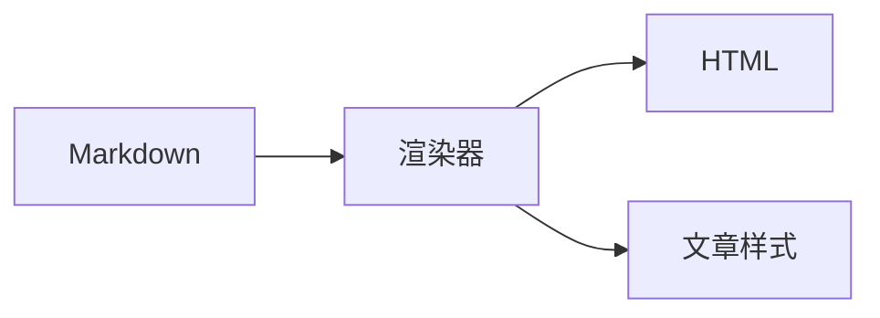
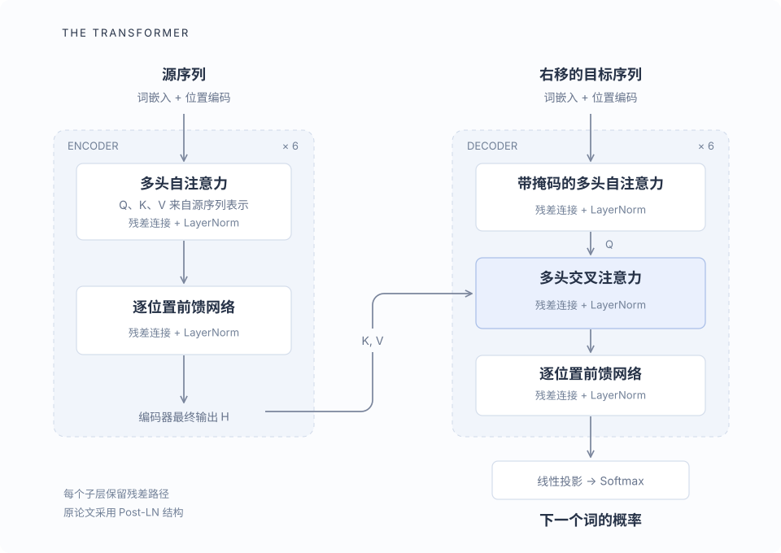

这是一篇写作草稿，可以在本地开发预览中阅读。准备发布时，将文章元数据中的 `draft` 设为 `false`。

## 行内效果与提示框

一段话里可以混用 ==黄色高亮==、++下划线++、~~细删除线~~、`行内代码`，以及 <kbd>Ctrl</kbd> + <kbd>K</kbd> 这样的键帽。

> [!NOTE]
> 说明用来补充背景。正文里的 `const`、数学公式和链接都会沿用文章本身的样式。

> [!TIP]
> 建议适合放写作提醒、阅读路径或一个更省事的做法。

> [!IMPORTANT]
> 重点会被强调色标出来，用来提醒这一段不能略过。

> [!WARNING]
> 警告用于容易出错的操作，比如析构对象后继续访问旧指针。

> [!CAUTION]
> 注意用于低风险但值得留心的边界条件。

<details>
<summary>折叠内容</summary>

`details` 可以收纳较长的补充说明。这里的摘要、图标和展开后的间距都跟随主题。

</details>

## 公式

行内公式与正文混排，例如 $E=mc^2$ 和 $\mathbb{R}^{n\times d}$。

独立公式可以使用对齐、矩阵、分段函数和手动编号：

$$
\begin{aligned}
f(x)&=x^2+2x+1,\\
f'(x)&=2x+2.
\end{aligned}
$$

$$
A=\begin{bmatrix}1&2\\3&4\end{bmatrix},
\qquad
g(x)=\begin{cases}x,&x\ge0,\\-x,&x<0.\end{cases}
\tag{1}
$$

## 代码

围栏代码块指定语言后会自动高亮。`title` 设置文件名，花括号指定强调的行。

~~~cpp title="example.cpp" {2}
int square(int value) {
    return value * value;
}
~~~

Diff 代码块会直接显示增删行：

```diff title="patch.diff"
- int square(int value) {
-     return value * value;
- }
+ int square(int value) {
+     const int result = value * value;
+     return result;
+ }
```

## Mermaid 图表



## 图片

Markdown 图片的替代文本用于描述内容，标题会显示为图注。



## 表格与列表

| 类型 | 例子 |
| --- | --- |
| 行内代码 | `std::uint64_t` |
| 数学表达式 | $\sum_{i=1}^{n}i$ |
| 强调 | **重点**与*斜体* |

- 普通列表可以嵌套。
  - 子项保留缩进。
- [x] 已检查公式
- [ ] 补充文章内容

> 引用可以用来补充解释或强调关键条件。
>
> 它也可以是多段引用，并和正文保持相同的行宽。

## 脚注

需要延伸说明时，可以使用脚注。[^note]

[^note]: 脚注自动编号，并提供返回正文的链接。
