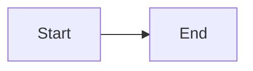

Orangutan is also mentioned on the project page. Search must return only this article.

## First section

Text before the target section.

## Target section

==Highlighted text== and ++underlined text++.

An underlined formula: ++$a^2+b^2=c^2$++.

C++ drafts and C++20 keep their pluses.

A wide inline formula: $\frac{x_{1}+x_{2}+x_{3}+x_{4}+x_{5}+x_{6}+x_{7}+x_{8}+x_{9}+x_{10}+x_{11}+x_{12}+x_{13}+x_{14}+x_{15}+x_{16}+x_{17}+x_{18}+x_{19}+x_{20}+x_{21}+x_{22}+x_{23}+x_{24}}{y_{1}+y_{2}+y_{3}+y_{4}+y_{5}+y_{6}+y_{7}+y_{8}+y_{9}+y_{10}+y_{11}+y_{12}+y_{13}+y_{14}+y_{15}+y_{16}+y_{17}+y_{18}+y_{19}+y_{20}+y_{21}+y_{22}+y_{23}+y_{24}}$.

$$
\sum_{i=1}^{n} x_i = x_1+x_2+x_3+x_4+x_5+x_6+x_7+x_8+x_9+x_{10}+x_{11}+x_{12}
$$

$$
A=\begin{bmatrix}1&2\\3&4\end{bmatrix},
\qquad
g(x)=\begin{cases}x,&x\ge0,\\-x,&x<0.\end{cases}
\tag{1}
$$

## HTML math

<div class="html-math">
  <p>Inline $x^2 + y^2 &lt; r^2$ costs $5 and <code>$n$</code> stays.</p>
  $$\int_0^1 x\,\mathrm{d}x = \frac12$$
</div>

```render html title="Fixture math frame"
<p id="static">Static $a^2+b^2=c^2$ and \(\mathbf{v}\) here.</p>
<p id="dynamic"></p>
<code>$raw$</code>
<script>
  document.getElementById('dynamic').textContent = '$$\\sum_{i=1}^{n} i$$';
</script>
```

```render html title="Fixture plain frame"
<p id="plain"></p>
<script>
  const pair = 'key value'.replace(/(\w+) (\w+)/, '$2 $1');
  document.getElementById('plain').textContent = `${pair} costs`;
</script>
```

## Callouts

> [!NOTE]
> Fixture note.

> [!TIP]
> Fixture tip.

> [!IMPORTANT]
> Fixture important.

> [!WARNING]
> Fixture warning.

> [!CAUTION]
> Fixture caution.

> [!THEOREM]- Folded $x$ title
> Folded body.

## Tabs

> [!TAB] Alpha
> Alpha panel.

> [!TAB] Beta
> Beta panel with $b^2$.

Between groups.

> [!TAB] Beta
> Second beta.

> [!TAB] Alpha
> Second alpha.

## Diff

```diff
 const keep = true;
-const answer = 1;
-const name = "same";
+const answer = 2;
+const name = "same";
+const added = true;
```

## Diagrams




```render svg title="Fixture SVG"
<svg viewBox="0 0 200 100" xmlns="http://www.w3.org/2000/svg">
  <circle cx="100" cy="50" r="40" fill="currentColor" />
</svg>
```

## Footnotes

Text with a footnote.[^fixture]

[^fixture]: Fixture footnote content.
